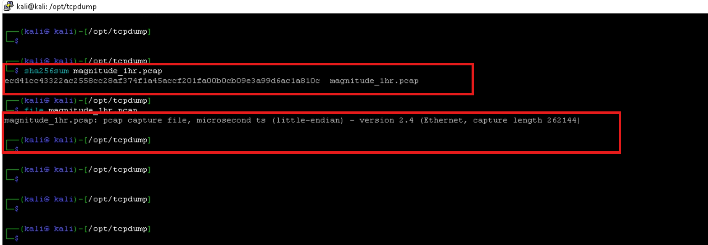
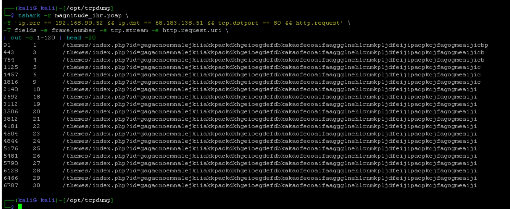

# Learning Network Traffic Analysis with TCPDump

**SOC Core Skills | Antisyphon Training | Hands-on Lab**

## About This Project

This is one of my first network traffic investigations while studying **SOC Core Skills in the Age of AI** by Antisyphon Training.

I have a networking background, but analyzing a PCAP file was something new for me.

At first, I wasn't sure where to start. There were so many packets and IP addresses that I found it difficult to understand what I was looking at.

I wanted to learn how to investigate network traffic step by step, not just copy commands from a tutorial.

This project follows the TCPDump exercise from the course, with some additional analysis using TShark.

## How I Approached the Lab

I learned that when investigating network traffic, it helps to start with a general view and then focus on specific connections.

I followed this simple process:

| Step | Question |
|---|---|
| 1. Check the file | What data am I working with? |
| 2. Explore the traffic | Which computers are communicating? |
| 3. Narrow the search | Which traffic should I focus on? |
| 4. Inspect the packets | What information is being exchanged? |
| 5. Follow the connection | Can I see the complete conversation? |
| 6. Review the results | What can I actually confirm? |

This helped me understand why I was using each command.

---

## 1. Getting Started

The course provided a file called `magnitude_1hr.pcap`.

A PCAP contains recorded network traffic that we can examine later.

I started by opening Kali Linux and checking the files inside `/opt/tcpdump`.


In this screenshot, I used commands such as `pwd` and `ls -l` to check my current directory and locate the capture file.

I also made a few mistakes while navigating the terminal. This was part of getting familiar with the lab environment.

### Checking the PCAP

Before examining the traffic, I wanted to know what kind of file I was working with.

```bash
sha256sum magnitude_1hr.pcap
file magnitude_1hr.pcap
```



The `file` command confirmed that this was a PCAP capture.

The `sha256sum` command generated a hash, which can help identify the file and check whether it changes.

**What I learned:** Before starting an investigation, it is useful to check and document the file I am analyzing.

---

## 2. Exploring the Network Traffic

### Looking at the packets

My first question was:

**What kind of information does this PCAP contain?**

I started by reading a small sample of packets using TCPDump.

```bash
tcpdump -n -tttt -r magnitude_1hr.pcap -c 20
```

The `-r` option reads the saved file, while `-c 20` limits the output to 20 packets.


The screenshot shows packet output from my initial exploration, along with some directory checks.

I noticed connections involving the internal IP address `192.168.99.52` and external systems.

However, looking at individual packets didn't give me a clear picture of the overall activity.

### Finding the main conversations

I wanted to know which computers were exchanging the most information.

```bash
tshark -r magnitude_1hr.pcap -q -z conv,ip
```

This command summarizes the conversations between IP addresses.


One conversation stood out:

| Information | Result |
|---|---|
| Internal IP | 192.168.99.52 |
| External IP | 68.183.138.51 |
| Total packets | 29,605 |
| Total traffic | Approximately 25 MB |
| Duration | Approximately 59 minutes |

The internal computer received approximately 24 MB and sent about 773 KB.

This could happen during a normal download, but it made me curious about what the computer was receiving.

**Next question: What kind of traffic was this computer generating?**

---

## 3. Focusing on One Computer

The course identified `192.168.99.52` as the computer to examine.

I used the `host` filter to focus on its traffic.

```bash
tcpdump -n -r magnitude_1hr.pcap 'host 192.168.99.52' -c 25
```


The screenshot highlights several types of activity:

1. **Host filter:** Shows packets involving `192.168.99.52`.
2. **TCP traffic:** The computer communicates with `167.71.97.235` on port 9200.
3. **ARP:** Used to find hardware addresses on a local network.
4. **DHCP:** Used to obtain network settings.
5. **IGMP:** Used for managing multicast group membership.

I learned that not every unfamiliar protocol is suspicious.

For example, ARP and DHCP are normal parts of network communication.

**Why did I continue?**

I still had several types of traffic mixed together. I wanted to focus on HTTP, which was part of the course exercise.

---

## 4. Investigating HTTP Traffic

I filtered the packets using the computer's IP address and port 80.

```bash
tcpdump -n -r magnitude_1hr.pcap \
'host 192.168.99.52 and port 80' -c 25
```


The numbered sections show:

1. The command used to filter HTTP traffic.
2. The TCP three-way handshake.
3. An HTTP GET request.
4. The server's `200 OK` response.
5. Data sent from the server to the computer.

### What did I find?

The computer established a connection with:

`68.183.138.51:80`

It then requested:

```text
GET /themes/index.php?id=...
```

A GET request means the client is asking the server for information.

The server responded:

```text
HTTP/1.1 200 OK
```

This means the request was answered successfully.

It does not mean the response was safe.

**Next question: What was inside the information sent by the server?**

---

## 5. Looking Inside the HTTP Response

The course pointed out a packet with the timestamp `15:14:32.638976`.

I used that timestamp to locate it instead of searching through hundreds of lines.

```bash
tcpdump -n -A -r magnitude_1hr.pcap \
'host 192.168.99.52 and port 80' 2>/dev/null \
| grep -A 2 -B 1 '15:14:32.638976'
```

The `-A` option displays readable text from packet data.


The highlighted sections show:

1. The command used to find the packet.
2. The timestamp and connection information.
3. PowerShell-related instructions.
4. A Base64 decoding instruction.
5. The beginning of a long encoded string.

### What did I find?

I found text containing:

```powershell
New-Object IO.MemoryStream
[Convert]::FromBase64String(...)
```

I learned that:

- `New-Object` creates an object in PowerShell.
- `MemoryStream` works with data stored in memory.
- `FromBase64String` converts Base64 text back into bytes.

Base64 is a way of representing information as text. It is not encryption.

This was interesting because I couldn't immediately understand what the encoded information contained.

However, finding PowerShell-related text in network traffic does not prove that it was executed.

### Examining the bytes

I also used TCPDump to view the packet in hexadecimal.

```bash
tcpdump -n -X -r magnitude_1hr.pcap \
'host 192.168.99.52 and port 80'
```


The screenshot shows the same packet information in hexadecimal and ASCII.

I could recognize parts of the PowerShell-related text in the ASCII column.

**What I learned:** A packet can be examined in different formats. ASCII is easier to read, while hexadecimal shows how the information is represented as bytes.

---

## 6. Looking at the Local Network

Before continuing with the HTTP response, I also wanted to understand which other local addresses appeared in the capture.

### Filtering the network range

```bash
tcpdump -n -r magnitude_1hr.pcap \
'net 192.168.99.0/24' -c 30
```


The screenshot shows several types of traffic involving the local network, including TCP, IGMP, ARP, and DHCP.

This helped me see that the PCAP contained more than just the HTTP connection I was examining.

### Finding unique IP addresses

Instead of reading all the packets, I used TShark to collect the unique internal IPv4 addresses.

```bash
tshark -r magnitude_1hr.pcap \
-T fields -e ip.src -e ip.dst \
| tr '\t' '\n' \
| grep '^192\.168\.99\.' \
| sort -u
```


The result showed eight unique addresses in the local network range.

One of them, `192.168.99.255`, is the broadcast address, not an individual computer.

This helped me understand the network scope, but it did not prove that other devices were involved in suspicious activity.

---

## 7. Finding the TCP Conversation

The HTTP response contained more data than could fit in a single packet.

I wanted to examine the complete connection instead of looking at individual packets.

### Identifying the TCP stream

TShark assigns a stream number to each TCP connection.

I searched for HTTP requests from the internal computer to the external server.

```bash
tshark -r magnitude_1hr.pcap \
-Y 'ip.src == 192.168.99.52 && ip.dst == 68.183.138.51 && tcp.dstport == 80 && http.request' \
-T fields -e frame.number -e tcp.stream -e http.request.uri \
| cut -c 1-120 | head -20
```



The result showed several TCP streams requesting similar HTTP paths.

The first request appeared in:

**Frame 91 — TCP Stream 1**

### Verifying the connection

I checked Frame 91 to confirm the IP addresses, ports, and stream number.

```bash
tshark -r magnitude_1hr.pcap \
-Y 'frame.number == 91' \
-T fields -e frame.time -e ip.src -e tcp.srcport \
-e ip.dst -e tcp.dstport -e tcp.stream
```


The result confirmed:

| Field | Value |
|---|---|
| Source | 192.168.99.52:52709 |
| Destination | 68.183.138.51:80 |
| TCP Stream | 1 |

**Why was this useful?**

Now I knew which connection to follow so I could examine the data exchanged between both computers.

---

## 8. Reconstructing the TCP Stream

I used TShark to reconstruct TCP Stream 1.

```bash
tshark -r magnitude_1hr.pcap \
-q -z follow,tcp,ascii,1 | less
```


The reconstructed conversation showed the same PowerShell-related instructions and a long encoded string.

The beginning of the string was similar to:

```text
H4sI...
```

I learned that this prefix is commonly associated with GZIP-compressed data represented in Base64.

However, I didn't decode and verify the complete content, so I couldn't confirm exactly what it contained.

### Saving the reconstructed data

I also saved a hexadecimal text representation of the connection.

```bash
tshark -r magnitude_1hr.pcap \
-q -z follow,tcp,raw,1 \
> /tmp/tcp-stream-1.txt
```


The screenshot confirms:

- The data came from TCP Stream 1.
- The connection involved `192.168.99.52` and `68.183.138.51`.
- The exported text file was approximately 445 KB.
- The content was saved as hexadecimal text.

This gave me another way to examine the conversation without changing the original PCAP.

---

## 9. Checking the HTTP Response Details

I wanted to know how much information the server reported sending and what type of content it was.

```bash
tshark -r magnitude_1hr.pcap \
-Y 'tcp.stream == 1 && http.response' \
-T fields \
-e frame.number \
-e http.response.code \
-e http.content_length \
-e http.content_encoding \
-e http.content_type
```


The screenshot shows:

| Field | Result |
|---|---|
| Frame | 375 |
| Response code | 200 |
| Content-Length | 226,788 bytes |
| Content-Type | text/plain |

The server reported sending approximately 227 KB of text.

The `text/plain` value does not mean the content was safe. It only describes how the server identified the response.

---

## 10. Checking Whether the Pattern Appeared Again

After finding the Base64 decoding instruction, I wanted to know if it appeared elsewhere in the capture.

I exported the HTTP objects using TShark.

```bash
mkdir -p /tmp/soc-analysis

tshark -r magnitude_1hr.pcap \
--export-objects http,/tmp/soc-analysis
```

Then I searched the exported files for the text `FromBase64String`.

```bash
grep -lF 'FromBase64String' /tmp/soc-analysis/* 2>/dev/null | wc -l

find /tmp/soc-analysis -maxdepth 1 -type f | wc -l
```


The screenshot shows:

1. The command used to search for `FromBase64String`.
2. **103 files** containing that text.
3. The command used to count all exported files.
4. **105 files** exported in total.

This suggests that similar PowerShell-related content appeared repeatedly in the captured HTTP traffic.

However, this does not mean that 103 attacks happened or that 103 computers were infected.

It only means that 103 exported files contained the text I searched for.

---

## 11. What Did I Find?

By the end of the lab, I could confirm that:

- The computer `192.168.99.52` communicated with `68.183.138.51` over HTTP.
- The server sent a response containing PowerShell-related instructions.
- The response included Base64-encoded data.
- Similar decoding instructions appeared in many exported HTTP files.
- Several other internal addresses were visible in the capture.

### Was this an attack?

The traffic contained unusual information that deserved further investigation.

However, I couldn't confirm that the computer executed the PowerShell code or that malware was installed.

A PCAP shows network communication, but it doesn't necessarily show what happened inside the computer.

In a real investigation, I would also check Windows event logs, PowerShell activity, and endpoint security alerts.

**Final assessment: Suspicious HTTP content observed. Successful execution or compromise not confirmed.**

---

## 12. What I Learned

This lab helped me understand that analyzing network traffic is not about reading every packet.

At first, the amount of information felt overwhelming.

What helped me was learning to start with a general view, narrow the search, and investigate one connection at a time.

I also learned that understanding why I use a command is just as important as knowing how to run it.

Finding something unusual doesn't automatically mean an attack happened. I need enough evidence before reaching that conclusion.

I still have a lot to learn, but this project helped me better understand how a SOC analyst can approach network traffic analysis.

---

## Tools Used

- Kali Linux
- TCPDump
- TShark
- Linux Command Line

## Acknowledgment

This project was completed while studying **SOC Core Skills in the Age of AI** by Antisyphon Training.

The original TCPDump exercise and PCAP were provided through the training material.

The additional analysis, screenshots, and explanations document my learning process.

The original PCAP and extracted payload files are not included in this repository.
