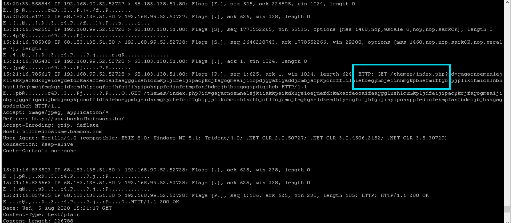
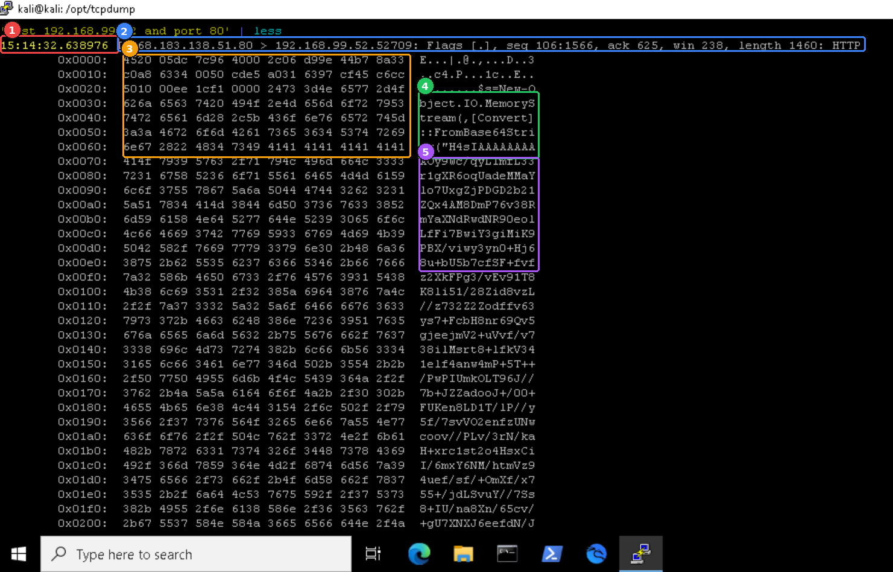
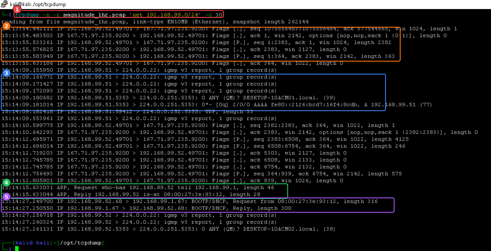
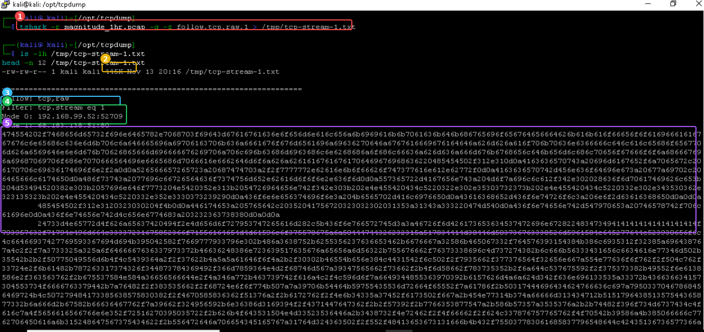
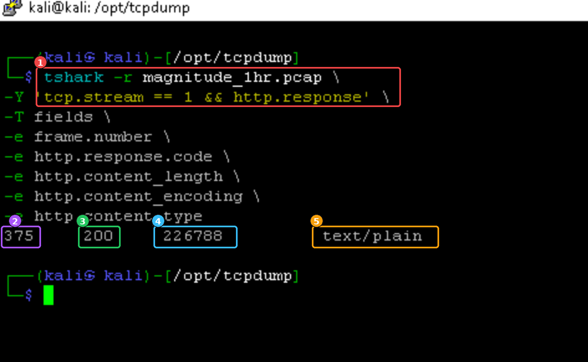

# Learning Network Traffic Analysis with TCPDump

**My First SOC Investigation | Antisyphon Training — SOC Core Skills**

## About This Project

This is my first network traffic analysis project, completed while studying **SOC Core Skills in the Age of AI** by Antisyphon Training.

I already had some networking knowledge, but I had little experience analyzing PCAP files.

When I first opened the capture, I saw so many packets, IP addresses, and protocols that I wasn't sure where to start.

I wanted to learn more than just how to run commands. I wanted to understand **why I was using each command, what I was looking for, and how the results could help me decide what to check next**.

This project follows the original TCPDump lab and includes some additional investigation using TShark.

## How I Approached the Investigation

Before starting, I wanted to understand how a SOC analyst could approach network traffic analysis.

I used this simple process to organize my work:

| Step | Question |
|---|---|
| 1. Check the evidence | What file am I analyzing? |
| 2. Explore the traffic | Which computers are communicating? |
| 3. Narrow the search | Which traffic should I focus on? |
| 4. Inspect the data | What information is being transferred? |
| 5. Follow the connection | Can I examine the complete conversation? |
| 6. Review the findings | What can I actually confirm? |

This is a simplified approach for my training lab, based on general incident investigation practices.

---

## 1. Preparing the Lab

The course provided a PCAP file called `magnitude_1hr.pcap`.

A PCAP is a file containing recorded network traffic. It allows us to go back and examine packets that were captured earlier.

### Checking the environment

I started by opening Kali Linux and locating the file.

```bash
cd /opt/tcpdump
ls -lh magnitude_1hr.pcap
```

**Why?** Before investigating anything, I needed to know which file I was working with.


### Checking the evidence

I also checked the file type and calculated its SHA-256 hash.

```bash
sha256sum magnitude_1hr.pcap
file magnitude_1hr.pcap
```

A hash helps identify a file and can be used to check whether it changes later.


**What I learned:** Checking the evidence before starting is an important habit when working with network captures.

---

## 2. Exploring the Network Traffic

### Looking at the first packets

My first question was:

**What kind of traffic is inside this PCAP?**

Instead of displaying thousands of packets, I started with a small sample.

```bash
tcpdump -n -tttt -r magnitude_1hr.pcap -c 20
```

I used `-c 20` to display only 20 packets and make the output easier to read.



I noticed different types of network traffic, including TCP connections and protocols used for local network communication.

One connection involved `192.168.99.52` and `167.71.97.235` on port `9200`.

At this point, I didn't know what the computers were exchanging.

### Finding the main conversations

I wanted a better overview of the capture.

**Which computers were communicating the most?**

```bash
tshark -r magnitude_1hr.pcap -q -z conv,ip
```

This command summarizes conversations between IP addresses instead of showing every packet individually.


One conversation stood out:

| Information | Result |
|---|---|
| Internal IP | `192.168.99.52` |
| External IP | `68.183.138.51` |
| Packets | 29,605 |
| Total traffic | Approximately 25 MB |
| Duration | Approximately 59 minutes |

The internal computer received much more data than it sent.

This could be normal, especially during a download. However, it made me curious about what the computer was receiving.

**Next question: What kind of information was being transferred?**

---

## 3. Focusing on the Computer

The course identified `192.168.99.52` as the computer to investigate.

I used a filter to show only traffic related to this address.

```bash
tcpdump -n -r magnitude_1hr.pcap 'host 192.168.99.52' -c 25
```


The output included several types of traffic, such as:

- TCP connections
- ARP messages
- DHCP traffic
- Multicast communication

ARP helps devices find hardware addresses, while DHCP helps devices receive network settings.

These are common networking activities.

**Why did I continue?**

There was still too much information, so I decided to focus on HTTP traffic, as introduced in the course.

---

## 4. Investigating HTTP Traffic

HTTP is commonly associated with port 80.

I filtered the traffic by host and port.

```bash
tcpdump -n -r magnitude_1hr.pcap \
'host 192.168.99.52 and port 80' -c 25
```


### What did I find?

I identified a connection between:

- **Client:** `192.168.99.52:52709`
- **Server:** `68.183.138.51:80`

The communication started with a TCP three-way handshake:

1. SYN — The client requests a connection.
2. SYN-ACK — The server responds.
3. ACK — The client confirms.

After that, the computer sent an HTTP GET request:

```text
GET /themes/index.php?id=...
```

The server responded with:

```text
HTTP/1.1 200 OK
```

This means the server successfully responded to the request.

However, I still didn't know what the response contained.

**Next question: Can I examine the information sent by the server?**

---

## 5. Looking Inside the HTTP Response

The course showed a specific packet at `15:14:32.638976`.

I used that timestamp to locate it without manually scrolling through the entire capture.

```bash
tcpdump -n -A -r magnitude_1hr.pcap \
'host 192.168.99.52 and port 80' 2>/dev/null \
| grep -A 2 -B 1 '15:14:32.638976'
```

The `-A` option displays readable text from the packet.


### What did I find?

I found PowerShell-related instructions:

```powershell
New-Object IO.MemoryStream
[Convert]::FromBase64String(...)
```

I learned that:

- `New-Object` creates an object in PowerShell.
- `MemoryStream` allows a program to work with data in memory.
- `FromBase64String` converts Base64 text into bytes.

Base64 is a way to represent information as text. It is not encryption.

These instructions caught my attention because I couldn't immediately understand what the encoded content contained.

However, finding this text in network traffic does not prove that it was executed.

### Viewing the packet in hexadecimal

I also wanted to understand how the information appeared in the actual packet bytes.

```bash
tcpdump -n -X -r magnitude_1hr.pcap \
'host 192.168.99.52 and port 80'
```



The hexadecimal view displays the bytes of the packet, while the ASCII view helps identify readable text.

**What I learned:** These are two ways of looking at the same information.

---

## 6. Checking the Internal Network

Before continuing with the HTTP response, I also wanted to understand which other devices appeared in the capture.

I started by filtering the local network range.

```bash
tcpdump -n -r magnitude_1hr.pcap \
'net 192.168.99.0/24' -c 30
```



Then I used TShark to identify the unique internal IP addresses.

```bash
tshark -r magnitude_1hr.pcap \
-T fields -e ip.src -e ip.dst \
| tr '\t' '\n' \
| grep '^192\.168\.99\.' \
| sort -u
```


I found several addresses in the local network, including:

- `192.168.99.1`
- `192.168.99.10`
- `192.168.99.51`
- `192.168.99.52`
- `192.168.99.53`
- `192.168.99.54`
- `192.168.99.55`

I also found `192.168.99.255`, which is the subnet broadcast address, not an individual computer.

This showed that the PCAP contained activity involving several internal addresses.

However, it did not prove that other devices were compromised.

---

## 7. Following the TCP Conversation

The HTTP response contained more information than could fit in a single packet.

I wanted to see the complete conversation instead of examining separate packets.

### Finding the TCP stream

TShark can identify the packets belonging to a specific TCP connection.

I searched for HTTP requests from the internal computer to the external server.

```bash
tshark -r magnitude_1hr.pcap \
-Y 'ip.src == 192.168.99.52 && ip.dst == 68.183.138.51 && tcp.dstport == 80 && http.request' \
-T fields -e frame.number -e tcp.stream -e http.request.uri \
| cut -c 1-120 | head -20
```


I found several TCP streams requesting similar HTTP paths.

The first relevant request appeared in **Frame 91, TCP Stream 1**.

### Verifying the connection

I checked that the stream belonged to the connection I was investigating.

```bash
tshark -r magnitude_1hr.pcap \
-Y 'frame.number == 91' \
-T fields -e frame.time -e ip.src -e tcp.srcport \
-e ip.dst -e tcp.dstport -e tcp.stream
```


The output confirmed the connection:

`192.168.99.52:52709 → 68.183.138.51:80`

**Why was this useful?**

Now I knew which TCP stream contained the HTTP request and could focus on that conversation.

---

## 8. Reconstructing the HTTP Conversation

I used TShark to follow TCP Stream 1.

```bash
tshark -r magnitude_1hr.pcap \
-q -z follow,tcp,ascii,1 | less
```

This command reconstructs the data exchanged during the connection and displays it in ASCII format.


### What did I find?

The reconstructed data included the same PowerShell-related instructions and a long encoded string.

The string started with:

```text
H4sI...
```

This prefix is commonly associated with Base64-encoded GZIP data.

GZIP is used to compress information.

I did not fully decode the content, so I couldn't confirm exactly what it contained.

### Saving the reconstructed stream

I also saved a hexadecimal representation of the TCP conversation.

```bash
tshark -r magnitude_1hr.pcap \
-q -z follow,tcp,raw,1 \
> /tmp/tcp-stream-1.txt
```



The resulting text file was approximately 445 KB.

This is the size of the exported text representation, not necessarily the original response size.

---

## 9. Checking the HTTP Response Details

I wanted to know how much information the server reported sending and what type of content it was.

```bash
tshark -r magnitude_1hr.pcap \
-Y 'tcp.stream == 1 && http.response' \
-T fields \
-e frame.number \
-e http.response.code \
-e http.content_length \
-e http.content_encoding \
-e http.content_type
```



### Results

| Field | Value |
|---|---|
| Frame | 375 |
| HTTP Status | 200 |
| Content-Length | 226,788 bytes |
| Content-Type | text/plain |
| Content-Encoding | Not reported |

The server reported sending approximately 227 KB of text data.

The `text/plain` content type does not necessarily mean the information was safe.

---

## 10. Looking for Repeated Activity

After finding PowerShell-related content, I wanted to know whether similar instructions appeared in other HTTP responses.

I exported the HTTP objects from the PCAP.

```bash
mkdir -p /tmp/soc-analysis

tshark -r magnitude_1hr.pcap \
--export-objects http,/tmp/soc-analysis
```

Then I searched the exported files for `FromBase64String`.

```bash
grep -lF 'FromBase64String' /tmp/soc-analysis/* 2>/dev/null | wc -l
find /tmp/soc-analysis -maxdepth 1 -type f | wc -l
```


### What did I find?

| Result | Count |
|---|---|
| Total exported HTTP files | 105 |
| Files containing FromBase64String | 103 |

This suggests that similar PowerShell-related content appeared repeatedly in the recorded HTTP traffic.

However, it does not mean that 103 attacks occurred or that 103 computers were infected.

It only means that 103 exported files contained the text I searched for.

---

## 11. What Did I Find?

By the end of the investigation, I was able to confirm that:

- `192.168.99.52` communicated with `68.183.138.51` over HTTP.
- The server returned a response containing PowerShell-related instructions.
- The response included Base64-encoded content.
- Similar decoding instructions appeared in many exported HTTP objects.
- Other internal IP addresses were visible in the capture.

### Was this an attack?

I found activity that deserved further investigation, but I couldn't confirm that the computer executed the PowerShell code or became infected.

A network capture shows information traveling between devices, but it does not always show what happened inside the computer.

In a real investigation, I would want to check Windows event logs, PowerShell activity, and endpoint security alerts before making a final conclusion.

**Final Assessment: Suspicious HTTP content observed. Successful execution or compromise not confirmed.**

---

## 12. What I Learned

This lab helped me understand that network traffic analysis is not about reading every packet.

At first, I found the amount of information overwhelming. What helped me was learning to start with a general view and then narrow the search.

I learned to ask questions such as:

- Which computer am I investigating?
- Who is it communicating with?
- What kind of traffic is being exchanged?
- What did the computer request?
- What did the server send back?
- What can I actually confirm?

I also learned that finding something unusual doesn't automatically mean an attack happened.

The most important lesson for me was understanding **why I was running each command**, rather than just following the instructions.

I still have a lot to learn, but this project helped me better understand how a SOC analyst can approach a network investigation.

---

## Tools Used

- Kali Linux
- TCPDump
- TShark
- Linux Command Line

## Acknowledgment

This project was completed while studying **SOC Core Skills in the Age of AI** by Antisyphon Training.

The original TCPDump exercise and PCAP were provided through the course. The additional analysis, screenshots, and explanations document my learning process.

The original PCAP and extracted payload files are not included in this public repository.
