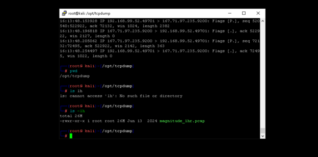
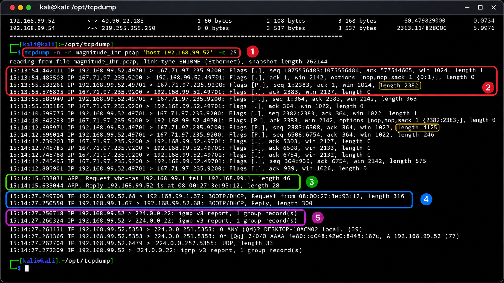
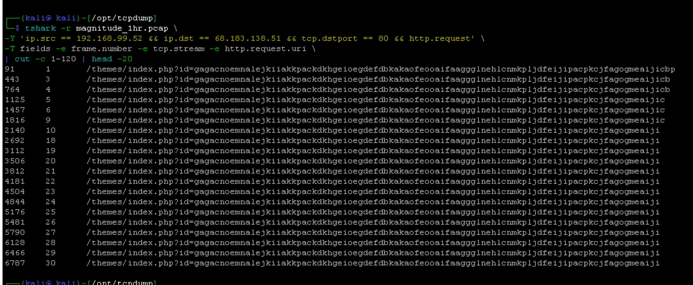
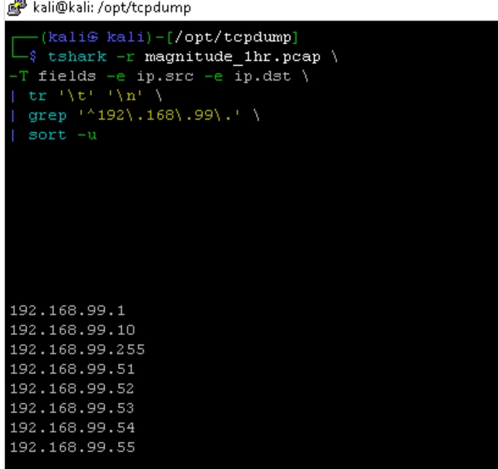

# What Was This Computer Downloading? — A TCPDump Investigation

**My first network traffic investigation | TCPDump + TShark | Beginner SOC lab**

## About This Project

I created this project while studying **SOC Core Skills in the Age of AI** from Antisyphon Training.

In the course, I learned how to read network traffic using TCPDump. But I wanted to go a little further than just running commands from the lesson.

I wanted to understand what I was looking at, why I was using each command, and how the information I found could help me decide what to investigate next.

This README follows my investigation step by step, including the questions I asked, the commands I used, and what I learned from the results.

> **Note:** This is a training lab using a PCAP provided with the course. It is not a real security incident that I investigated at work. The network traffic was captured on August 5, 2020.

---

## 1. What Am I Trying to Find?

Imagine a computer on a company network is communicating with an external server.

As someone learning to work in a Security Operations Center (SOC), I would want to answer a few questions:

- Who is this computer communicating with?
- What kind of traffic is being exchanged?
- What information is the computer receiving?
- Is there anything unusual that needs further investigation?

For this lab, the computer I am investigating has the IP address:

**`192.168.99.52`**

My main question is:

**What was this computer receiving over the network, and was there anything suspicious about it?**

### A Few Terms Before Starting

If you're new to networking, here are some terms that helped me understand this lab.

| Term | What it means |
|---|---|
| IP address | A number used to identify a device on a network |
| Packet | A small piece of data traveling across a network |
| PCAP | A file containing previously captured network packets |
| TCPDump | A command-line tool used to capture and inspect network traffic |
| TShark | The command-line version of Wireshark |
| HTTP | A protocol used by clients and servers to exchange web content |
| Payload | The actual data being carried inside a packet |
| TCP Stream | The packets belonging to one TCP connection |

I used a file called `magnitude_1hr.pcap`.

A PCAP is like a recording of network activity. Instead of watching the traffic live, I can go back and examine what happened.

---

## 2. Preparing the Lab

### What do I need before starting?

First, I need to make sure I have the correct file.

I am using a Kali Linux virtual machine provided for the training lab.



I navigate to the directory containing the capture:

```bash
cd /opt/tcpdump
ls -lh magnitude_1hr.pcap
```

### Why am I doing this?

Before starting an investigation, I need to know what evidence I am working with.

I also want to check that the file exists and that I can read it.

Next, I use:

```bash
sha256sum magnitude_1hr.pcap
file magnitude_1hr.pcap
```

The first command calculates a SHA-256 hash.

A hash is a value that helps identify a file. If the file changes, its hash will usually change too.

The second command identifies the type of file.


### What did I find?

Linux identified the file as a PCAP network capture.

I also calculated its SHA-256 hash so I could document the evidence I was using.

### What comes next?

Now that I know I have the correct capture, I can begin exploring the network traffic.

---

## 3. Looking at the Network Traffic for the First Time

### My question

**What kind of traffic is inside this PCAP?**

I don't want to start by displaying thousands of packets because I wouldn't know what to focus on.

Instead, I want to look at a small sample first.

### Command

```bash
tcpdump -n -tttt -r magnitude_1hr.pcap -c 20
```

### Why this command?

| Option | Meaning |
|---|---|
| `-n` | Show IP addresses without converting them to names |
| `-tttt` | Display the full date and time |
| `-r` | Read packets from a saved file |
| `-c 20` | Display only 20 packets |

This allows me to understand the structure of the data without overwhelming the terminal.


### What did I find?

The capture contains different types of network traffic.

I noticed TCP communications, along with other protocols used by devices on a network.

One connection involved:

- Internal IP: `192.168.99.52`
- External IP: `167.71.97.235`
- Remote port: `9200`

Port 9200 can be used by services such as Elasticsearch, but the port number alone does not tell me which application is running.

### What does this mean?

At this point, I only know that the computer is communicating with another system.

I don't have enough information to say whether the connection is normal or suspicious.

### Why did I continue?

Looking at only 20 packets is useful, but it doesn't show me which communications are the most important in the whole capture.

My next question is:

**Which computers are communicating the most?**

---

## 4. Finding the Main Network Conversations

### My question

**Who is talking to whom, and how much data are they exchanging?**

Instead of reading every packet, I want a summary of the network conversations.

### Command

```bash
tshark -r magnitude_1hr.pcap -q -z conv,ip
```

### Why this command?

TShark can group packets by IP address pairs.

This helps me see which computers communicate with each other, how much traffic they exchange, and how long the observed communication lasts.


### What did I find?

One conversation stood out:

**`192.168.99.52 ↔ 68.183.138.51`**

| Information | Result |
|---|---|
| Total packets | 29,605 |
| Total traffic | Approximately 25 MB |
| Observed duration | Approximately 59 minutes |
| Data received by the internal computer | Approximately 24 MB |
| Data sent in the other direction | Approximately 773 KB |

### Why did this catch my attention?

The internal computer received much more data than it sent.

This could happen during a normal download. It could also happen when a computer receives scripts or other files from a remote server.

The amount of traffic alone does not mean something malicious happened.

But it gives me a reason to look more closely at this conversation.

### My next question

**What kind of information was the computer receiving from this server?**

To find out, I need to focus on the computer and remove traffic that is not relevant to my investigation.

---

## 5. Filtering Traffic from the Computer

### My question

**Can I see only the packets related to the computer I am investigating?**

The PCAP contains traffic from different devices.

I want to focus on `192.168.99.52`.

### Command

```bash
tcpdump -n -r magnitude_1hr.pcap 'host 192.168.99.52' -c 25
```

### Why this command?

The `host` filter shows packets where the selected IP address is either the sender or receiver.

This removes packets that don't involve the computer I am investigating.



### What did I find?

The computer is involved in several types of traffic, including:

- TCP connections with external IP addresses
- ARP messages
- DHCP traffic
- Multicast communications

ARP helps devices find hardware addresses on a local network.

DHCP helps devices obtain network settings.

These are common networking activities and are not automatically suspicious.

### Why did I continue?

I can now see traffic related to my computer, but there are still different protocols mixed together.

Since this exercise focuses on HTTP communications, I decided to filter by port 80 next.

---

## 6. Looking at HTTP Traffic

### My question

**What was this computer requesting from the external server?**

HTTP is commonly associated with port 80.

### Command

```bash
tcpdump -n -r magnitude_1hr.pcap \
'host 192.168.99.52 and port 80' -c 25
```

### Why this command?

I am combining two filters:

- `host 192.168.99.52` focuses on the computer.
- `port 80` focuses on traffic using that port.

This helps me see a smaller, more relevant part of the capture.


### What did I find?

I identified communication between:

**Client:** `192.168.99.52:52709`

**Server:** `68.183.138.51:80`

The communication begins with a TCP three-way handshake.

This is how two computers establish a TCP connection.

The sequence is:

1. SYN — The client asks to start a connection.
2. SYN-ACK — The server responds.
3. ACK — The client confirms the connection.

After the connection was established, the computer sent an HTTP GET request.

The request included this path:

```text
GET /themes/index.php?id=...
```

A GET request means the computer is asking the server for a resource.

The server responded with:

```text
HTTP/1.1 200 OK
```

### What does 200 OK mean?

It means the server successfully responded to the HTTP request.

It does not mean the content is safe.

### Why did I continue?

Now I know the computer requested something from the server and received a response.

But I still don't know what was inside that response.

My next question is:

**Can I read the information the server sent back?**

---

## 7. Looking Inside the HTTP Response

### My question

**What is actually inside the data being transferred?**

Until now, I have mostly been looking at information about the packets.

I want to examine the content.

TCPDump has an option called `-A` that displays readable ASCII text from packets.

At first, I tried searching for the word `powershell`, but I didn't find anything.

I learned something important here:

**Searching for the name of a program doesn't always help. Sometimes the data contains the program's commands without containing its name.**

The course provided a timestamp associated with a packet worth investigating.

I used that timestamp to find it.

### Command

```bash
tcpdump -n -A -r magnitude_1hr.pcap \
'host 192.168.99.52 and port 80' 2>/dev/null \
| grep -A 2 -B 1 '15:14:32.638976'
```

### Why this command?

Instead of searching for an unknown word, I am looking for a specific packet using its timestamp.

The `grep` command helps me locate the matching line and display nearby text.

### What did I find?

I found these PowerShell-related instructions inside the HTTP response:

```powershell
New-Object IO.MemoryStream
[Convert]::FromBase64String(...)
```


### What does this mean?

Let's break it down.

**New-Object**

This is used in PowerShell to create an object.

**MemoryStream**

A MemoryStream allows a program to work with data in memory.

**FromBase64String**

This converts text encoded in Base64 back into bytes.

Base64 is not encryption. It is a way of representing data using text characters.

It is used for many legitimate reasons, but it can also be used to hide the appearance of scripts or other content.

### Why is this interesting?

The server sent content containing PowerShell instructions and a long encoded string.

This deserves further investigation because I don't yet know what the encoded information contains.

However, I cannot say that the computer executed the script.

I can only confirm that the content appeared in the captured network traffic.

### My next question

**Can I inspect the actual bytes to understand how this content is stored in the packet?**

---

## 8. Understanding the Hexadecimal View

### My question

**How does the text I found appear inside the actual packet data?**

### Command

```bash
tcpdump -n -X -r magnitude_1hr.pcap \
'host 192.168.99.52 and port 80'
```

### Why this command?

The `-X` option shows two representations of the packet data:

- Hexadecimal values
- Readable ASCII characters

Hexadecimal is a way of representing bytes using numbers from 0 to 9 and letters from A to F.

For example:

```text
Hexadecimal: 4e65 772d 4f62 6a65 6374
ASCII:       New-Object
```

Both represent the same bytes.


### What did I find?

I could see that the PowerShell-related text was present in the actual packet bytes.

### What did I learn?

The ASCII view is easier to read, while hexadecimal helps show the underlying data.

### Why did I continue?

A single packet only contains part of the server's response.

To understand the complete response, I need to examine the packets belonging to the same TCP connection.

---

## 9. Identifying the TCP Stream

### My question

**How can I put the packets from one connection together?**

When two computers communicate over TCP, a message may be divided into several packets.

To understand a longer message, I need to identify which packets belong to the same connection.

TShark assigns stream numbers to TCP connections.

### Command

```bash
tshark -r magnitude_1hr.pcap \
-Y 'ip.src == 192.168.99.52 && ip.dst == 68.183.138.51 && tcp.dstport == 80 && http.request' \
-T fields -e frame.number -e tcp.stream -e http.request.uri \
| cut -c 1-120 | head -20
```

### Why this command?

I wanted to identify HTTP requests sent by my computer to the external server.

The output gives me:

- Frame number
- TCP stream number
- Requested HTTP path


### What did I find?

There were multiple TCP streams containing requests with similar HTTP paths.

The first HTTP request appeared in:

**Frame 91 — TCP Stream 1**

I verified this using:

```bash
tshark -r magnitude_1hr.pcap \
-Y 'frame.number == 91' \
-T fields -e frame.time -e ip.src -e tcp.srcport \
-e ip.dst -e tcp.dstport -e tcp.stream
```



The result confirmed:

| Field | Value |
|---|---|
| Source IP | `192.168.99.52` |
| Source port | `52709` |
| Destination IP | `68.183.138.51` |
| Destination port | `80` |
| TCP stream | `1` |

### Why did I continue?

Now I know exactly which TCP connection contains the HTTP request I am investigating.

Instead of looking at individual packets, I can follow that specific conversation.

---

## 10. Reconstructing the TCP Conversation

### My question

**Can I see the full conversation instead of separate packets?**

### Command

```bash
tshark -r magnitude_1hr.pcap \
-q -z follow,tcp,ascii,1 | less
```

### Why this command?

The `follow,tcp,ascii,1` option reconstructs TCP Stream 1 and displays its data in a readable text format.

This helps me examine content that was originally divided across several packets.


### What did I find?

I found the same PowerShell-related instructions, followed by a long encoded string.

The string began with:

```text
H4sI...
```

This is commonly seen at the beginning of Base64-encoded GZIP data.

GZIP is a format used to compress data.

However, I did not completely decode and verify the content, so I cannot confirm exactly what was inside.

### Why did I continue?

I wanted to keep a copy of the reconstructed connection that I could inspect without changing the original PCAP.

### Command

```bash
tshark -r magnitude_1hr.pcap \
-q -z follow,tcp,raw,1 \
> /tmp/tcp-stream-1.txt
```

This command saves a hexadecimal text representation of the TCP stream.


The exported text file was approximately 445 KB.

This does not mean the actual HTTP response was 445 KB, because the file contains a hexadecimal text representation of the stream.

### My next question

**What information can the HTTP response headers tell me about the data sent by the server?**

---

## 11. Checking the HTTP Response Details

### My question

**How large was the response, and what type of content did the server say it was sending?**

### Command

```bash
tshark -r magnitude_1hr.pcap \
-Y 'tcp.stream == 1 && http.response' \
-T fields \
-e frame.number \
-e http.response.code \
-e http.content_length \
-e http.content_encoding \
-e http.content_type
```

### Why this command?

HTTP responses can contain information describing the returned content.

I wanted to check the response status, reported size, and content type.

### What did I find?

| Field | Result |
|---|---|
| Frame | 375 |
| HTTP Status | 200 |
| Content-Length | 226,788 bytes |
| Content-Type | text/plain |
| Content-Encoding | Not reported |


### What does this mean?

The server reported sending approximately 227 KB of text data.

The `text/plain` type means the server described the content as plain text.

It does not mean the content was safe.

### Why did I continue?

I had already found PowerShell-related syntax in one HTTP response.

I wanted to know whether the same pattern appeared repeatedly in the capture or whether it was an isolated observation.

---

## 12. Checking Whether the Pattern Appeared Again

### My question

**Was this the only HTTP response containing that PowerShell instruction?**

I decided to export the HTTP objects and search for the same text.

### Commands

```bash
mkdir -p /tmp/soc-analysis

tshark -r magnitude_1hr.pcap \
--export-objects http,/tmp/soc-analysis
```

This extracts HTTP objects from the capture into a temporary folder.

I then searched for files containing the exact text:

```bash
grep -lF 'FromBase64String' /tmp/soc-analysis/* 2>/dev/null | wc -l
```

To count the total exported files:

```bash
find /tmp/soc-analysis -maxdepth 1 -type f | wc -l
```

### What did I find?

| Result | Count |
|---|---:|
| Total exported HTTP files | 105 |
| Files containing FromBase64String | 103 |


### What does this mean?

The same decoding-related instruction appeared in many of the exported HTTP files.

This suggests that similar content was being delivered repeatedly.

However, **103 matching files does not mean 103 attacks or 103 infected computers**.

It only means that 103 exported files contained the text I searched for.

Also, this export covered HTTP objects from the whole PCAP, not only TCP Stream 1.

### What did I learn?

When investigating suspicious traffic, looking for repeated patterns can provide more context than examining one packet alone.

But I also need to be careful about what those patterns actually prove.

---

## 13. Checking the Internal Network

### My question

**Were other internal devices visible in the capture?**

So far, I had focused mainly on `192.168.99.52`.

I also wanted to understand what other devices appeared in the local network.

### Command

```bash
tcpdump -n -r magnitude_1hr.pcap \
'net 192.168.99.0/24' -c 30
```

### Why this command?

The `net` filter allows me to look at traffic involving an entire network range.

Instead of investigating one computer, I can examine activity involving the subnet.


I also used TShark to identify unique IP addresses:

```bash
tshark -r magnitude_1hr.pcap \
-T fields -e ip.src -e ip.dst \
| tr '\t' '\n' \
| grep '^192\.168\.99\.' \
| sort -u
```



### What did I find?

The capture contained these addresses:

```text
192.168.99.1
192.168.99.10
192.168.99.255
192.168.99.51
192.168.99.52
192.168.99.53
192.168.99.54
192.168.99.55
```

The screenshot shows eight addresses in this query.

`192.168.99.255` is a broadcast address, not an individual computer.

### What does this mean?

Other devices were visible in the network capture.

This is useful context, but it does not prove that those devices were involved in malicious activity.

To investigate possible movement between computers, I would need to examine internal connections in more detail.

---

## 14. Putting the Events in Order

One thing I learned during this lab is that timestamps are useful for understanding how a network conversation developed.

Here is a short timeline based on the packets I examined.

| Time (UTC) | What happened |
|---|---|
| 15:14:32.544305 | The internal computer starts a TCP connection |
| 15:14:32.587347 | The server responds with SYN-ACK |
| 15:14:32.587412 | The client completes the TCP handshake |
| 15:14:32.587599 | The computer sends an HTTP GET request |
| 15:14:32.638566 | The server returns HTTP 200 OK |
| 15:14:32.638976 | A server response packet contains PowerShell-related content and Base64 data |

These events happened on **August 5, 2020**, according to the PCAP.

### Why does the timeline matter?

Instead of treating every packet as unrelated information, I can see how one action leads to another.

The computer establishes a connection, requests something, and then receives data from the server.

This helps me explain the network activity in a way that is easier to follow.

---

## 15. So, Was This an Attack?

This was the biggest question I had while working on the lab.

After reviewing the traffic, I found several things worth investigating:

- An internal computer communicated with an external server over HTTP.
- The server sent a long HTTP response.
- The response contained PowerShell-related syntax.
- The content included Base64-encoded data.
- Similar decoding instructions appeared in many exported HTTP files.

These observations make the traffic interesting from a security perspective.

However, **I cannot confirm that the computer was infected or that the script was executed**.

A PCAP shows network communications, but it does not necessarily tell me what a computer did after receiving the data.

### What would I investigate next in a real SOC?

If this were a real security alert, I would want to check:

1. **Endpoint logs:** Did PowerShell run on the computer?
2. **Process activity:** Was a suspicious process created?
3. **Security alerts:** Did an endpoint security tool detect anything?
4. **Decoded content:** What does the encoded information actually contain?
5. **Other systems:** Did the computer communicate with additional internal hosts in unusual ways?

These additional sources could help determine whether the activity was malicious.

### Final Assessment

**Suspicious HTTP content observed. Successful execution or compromise not confirmed.**

---

## 16. What I Learned

This was my first detailed investigation using TCPDump and TShark.

At the beginning, I found it difficult to understand the amount of information displayed in the terminal.

There were so many IP addresses, ports, timestamps, and long lines of data that I wasn't sure what I should focus on.

What helped me most was learning to ask one question at a time.

Instead of trying to understand the entire PCAP immediately, I followed a sequence:

**Which computer am I investigating?**

↓

**Which servers is it communicating with?**

↓

**Which connection should I examine?**

↓

**What did the computer request?**

↓

**What did the server send back?**

↓

**Is there anything unusual inside the response?**

↓

**What can I actually confirm from the evidence?**

I also learned that finding something suspicious does not automatically mean I have found an attack.

PowerShell and Base64 can have legitimate uses, so I need more information before reaching a conclusion.

This project helped me understand how network traffic analysis can be used during a security investigation and how important it is to explain the reasoning behind each step.

I still have a lot to learn, especially about analyzing encoded payloads and investigating endpoint activity, but this lab gave me a better understanding of how to approach a network investigation.

---

## Tools Used

- **Kali Linux** — Lab environment
- **TCPDump** — Packet filtering and inspection
- **TShark** — Network conversation analysis and TCP stream reconstruction
- **Linux CLI** — File inspection, searching, and basic evidence handling

## Additional Screenshots

All screenshots from the investigation are available in the [screenshots folder](screenshots/).

This includes intermediate steps such as file verification, packet filtering, TCP stream identification, and extracted HTTP object analysis.

## Course Credit

This project was created as part of my learning journey while studying **SOC Core Skills in the Age of AI** by Antisyphon Training.

The original TCPDump lab and PCAP dataset were provided through the course.

The screenshots, explanations, and investigation notes in this repository document my own learning process.

The original PCAP and extracted payload files are not included in this public repository.
