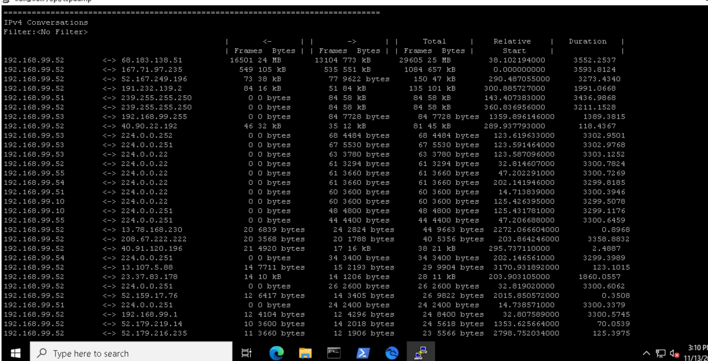
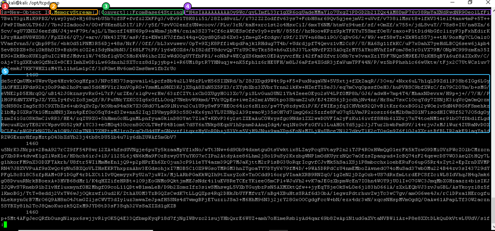
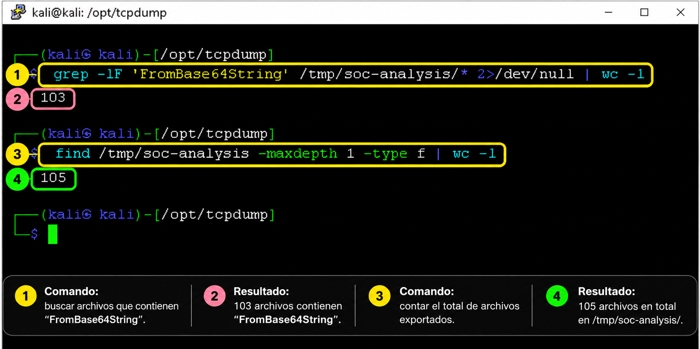

# Network Traffic Investigation with TCPDump

**SOC Core Skills Lab | Antisyphon Training**

## About This Project

This is one of my first hands-on network traffic investigations, completed while studying **SOC Core Skills in the Age of AI** by Antisyphon Training.

I already had some networking knowledge, but I had little experience analyzing packet captures. When I first looked at the PCAP, there was so much information that I wasn't sure where to start.

My goal was to learn how to approach network traffic step by step, understand why I was using each command, and recognize activity that might need further investigation.

This is a guided training lab that I extended with additional analysis using TShark.

## How I Approached the Investigation

Before starting, I wanted to understand the basic process a SOC analyst could follow when reviewing network traffic.

| Step | Question |
|---|---|
| 1. Check the evidence | What file am I working with? |
| 2. Explore the traffic | Which computers are communicating? |
| 3. Narrow the search | Which connections should I investigate? |
| 4. Inspect the data | What information is being transferred? |
| 5. Review the findings | What can I confirm from the evidence? |

This gave me a simple way to organize the investigation instead of trying to understand every packet at once.

## 1. Preparing the Lab

The course provided a network capture called `magnitude_1hr.pcap` and introduced an internal computer with the IP address `192.168.99.52`.

A PCAP is a file containing recorded network packets.

I started by checking that the file was available and identifying its format.

```bash
cd /opt/tcpdump
ls -lh magnitude_1hr.pcap
sha256sum magnitude_1hr.pcap
file magnitude_1hr.pcap
```

The SHA-256 command creates a hash that can help identify the file if I need to check it again.


## 2. Understanding the Network Traffic

I started by reviewing a small number of packets.

```bash
tcpdump -n -tttt -r magnitude_1hr.pcap -c 20
```

I used `-c 20` because displaying every packet would make the output difficult to read.

After that, I wanted to know which computers exchanged the most data.

```bash
tshark -r magnitude_1hr.pcap -q -z conv,ip
```



One conversation stood out:

| Information | Result |
|---|---|
| Internal IP | `192.168.99.52` |
| External IP | `68.183.138.51` |
| Total packets | 29,605 |
| Total traffic | Approximately 25 MB |
| Observed duration | Approximately 59 minutes |

The internal computer received much more data than it sent.

This doesn't necessarily mean something malicious happened. However, it made me curious about what the computer was receiving.

**My next question was: What kind of information was being transferred?**

## 3. Filtering the Traffic

The PCAP contained different protocols and connections.

I first focused on the internal computer and then narrowed the search to port 80, commonly used for HTTP.

```bash
tcpdump -n -r magnitude_1hr.pcap 'host 192.168.99.52 and port 80' -c 25
```


I identified an HTTP connection between:

- **Client:** `192.168.99.52:52709`
- **Server:** `68.183.138.51:80`

The computer sent a GET request to:

`/themes/index.php?id=...`

The server responded with `HTTP/1.1 200 OK`.

This told me that the server responded to the request, but I still didn't know what the response contained.

## 4. Looking Inside the HTTP Response

The course showed a specific packet worth examining at `15:14:32.638976`.

I used its timestamp to find the content more easily.

```bash
tcpdump -n -A -r magnitude_1hr.pcap \
'host 192.168.99.52 and port 80' 2>/dev/null \
| grep -A 2 -B 1 '15:14:32.638976'
```


Inside the response, I found PowerShell-related instructions:

```powershell
New-Object IO.MemoryStream
[Convert]::FromBase64String(...)
```

I learned that `MemoryStream` is used to work with data in memory, while `FromBase64String` converts Base64 text into bytes.

Base64 is a way of representing data as text. It is not encryption.

These instructions caught my attention because I couldn't immediately tell what the encoded data contained.

However, finding PowerShell-related content in network traffic does not prove that it was executed.

## 5. Following the TCP Conversation

The server response was divided across multiple TCP packets.

Instead of looking at each packet separately, I wanted to examine the complete connection.

Using TShark, I identified **TCP Stream 1**, which contained the HTTP request from the internal computer.

```bash
tshark -r magnitude_1hr.pcap -q -z follow,tcp,ascii,1 | less
```



The reconstructed conversation showed the PowerShell-related instructions followed by a long encoded string.

The string started with `H4sI...`, which is commonly associated with Base64-encoded GZIP data.

I did not fully decode the content, so I could not confirm what was inside.

I also checked the HTTP response details.


| Field | Value |
|---|---|
| HTTP Status | 200 OK |
| Content-Length | 226,788 bytes |
| Content-Type | text/plain |

The server described the response as plain text, but that does not necessarily mean the content was safe.

## 6. Checking for Repeated Activity

After finding the PowerShell-related instructions, I wanted to know whether similar content appeared elsewhere in the capture.

I exported the HTTP objects and searched for the same instruction.

```bash
mkdir -p /tmp/soc-analysis
tshark -r magnitude_1hr.pcap --export-objects http,/tmp/soc-analysis

grep -lF 'FromBase64String' /tmp/soc-analysis/* 2>/dev/null | wc -l
find /tmp/soc-analysis -maxdepth 1 -type f | wc -l
```



I found:

- **105 HTTP objects** exported from the capture.
- **103 files** containing `FromBase64String`.

This suggests that similar encoded content appeared repeatedly in the captured HTTP traffic.

It does not mean that 103 attacks or infections occurred.

## 7. Checking the Internal Network

I also wanted to see which other internal IP addresses appeared in the PCAP.

```bash
tshark -r magnitude_1hr.pcap \
-T fields -e ip.src -e ip.dst \
| tr '\t' '\n' \
| grep '^192\.168\.99\.' \
| sort -u
```


I found several internal addresses in the `192.168.99.0/24` network.

This helped me understand that the capture contained activity from more than one device.

However, I did not find enough evidence to conclude that other computers were compromised.

## 8. What Did I Find?

At the end of the investigation, I was able to confirm that:

- `192.168.99.52` communicated with `68.183.138.51` over HTTP.
- The server returned a response containing PowerShell-related instructions.
- The response included Base64-encoded content.
- Similar decoding instructions appeared in many exported HTTP objects.

**My assessment:** The HTTP content was unusual and worth investigating, but I could not confirm malware execution or a successful attack using network traffic alone.

In a real investigation, I would want to examine Windows event logs, PowerShell activity, and endpoint security alerts before reaching a conclusion.

## 9. What I Learned

This lab helped me understand that network traffic analysis is not about reading every packet.

At first, I found the amount of information overwhelming. What helped was learning to start with a general view and then narrow the search based on what I found.

I also learned that identifying something suspicious is different from proving that an attack happened.

The most useful lesson for me was understanding **why I was running each command**, rather than just following the instructions.

I still have a lot to learn, but this project gave me a better idea of how a SOC analyst can approach a network investigation.

---

## Tools Used

- Kali Linux
- TCPDump
- TShark
- Linux command line

## Additional Evidence

More screenshots from this investigation are available in the [screenshots folder](screenshots/), including initial packet inspection, hexadecimal analysis, TCP stream verification, and network scope analysis.

## Acknowledgment

This project was completed while studying **SOC Core Skills in the Age of AI** by Antisyphon Training.

The original TCPDump exercise and PCAP were provided through the training material. The additional analysis, screenshots, and explanations document my learning process.

The original PCAP and extracted payload files are not included in this repository.
