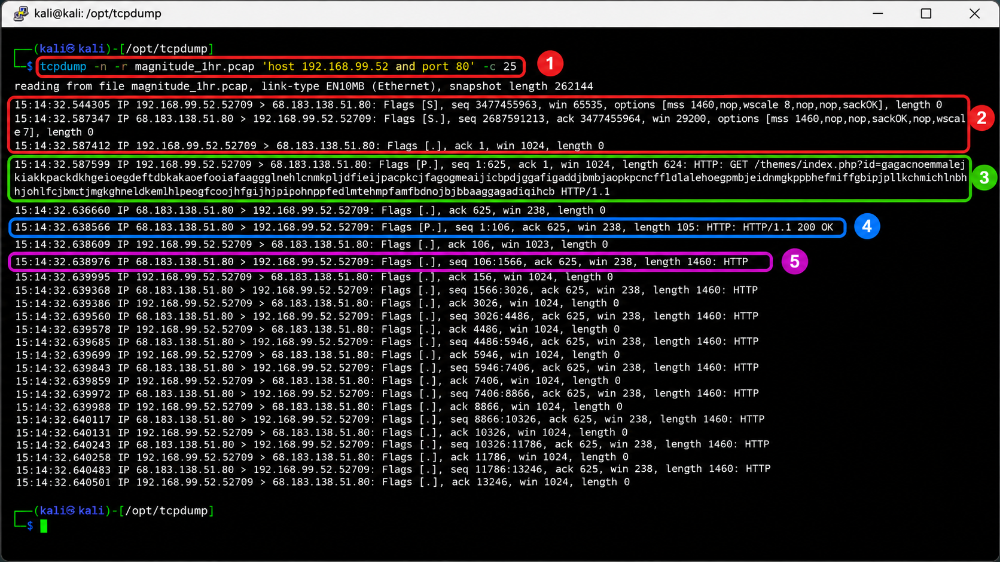
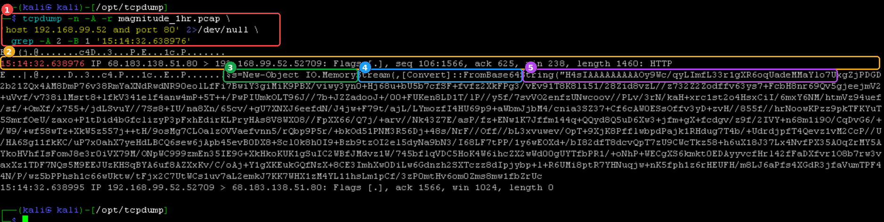

# Investigating Suspicious HTTP Traffic with TCPDump and TShark

**A beginner SOC analyst lab | Network traffic analysis | PCAP investigation**

I built this project while studying **SOC Core Skills in the Age of AI** by Antisyphon Training. The original TCPDump exercise introduces packet filtering and packet inspection. I wanted to go a little further and practice investigating a specific network conversation, keeping track of what I could actually prove.

This is a **guided training-lab investigation**, not a real-world incident response case. I followed the course material for the fundamentals and added my own analysis using TShark, TCP stream reconstruction, and HTTP object inspection.

## Quick overview

| Item | Details |
|---|---|
| Role practiced | Junior SOC analyst / network traffic analyst |
| Environment | Kali Linux lab VM |
| Tools | TCPDump, TShark, Linux CLI (`grep`, `sort`, `sha256sum`, `file`) |
| Evidence | `magnitude_1hr.pcap` (course-provided PCAP) |
| Host investigated | `192.168.99.52` |
| HTTP peer | `68.183.138.51:80` |
| Key TCP stream | `1` |
| Capture date | August 5, 2020 (as recorded in the PCAP) |
| Result | Suspicious PowerShell-related content observed in an HTTP response; execution **not confirmed** |

> **Scope:** I analyzed a historical lab capture. The scenario is educational; the public IPs and URLs are observations from the dataset, not an assertion that they are currently malicious.

## 1. Investigation question

The main question was straightforward:

**What was the internal host `192.168.99.52` receiving over HTTP, and what makes the traffic worth investigating?**

To answer it, I tried to:
1. Understand the capture and identify the busiest conversations.
2. Narrow the traffic to one host and HTTP.
3. Inspect the request and server response.
4. Reconstruct the associated TCP stream.
5. Record what the payload shows—and what it **doesn't** show.

## 2. Preparing and checking the evidence

I started by locating the provided PCAP in `/opt/tcpdump` and checking its type and SHA-256 hash:

```bash
cd /opt/tcpdump
ls -lh magnitude_1hr.pcap
sha256sum magnitude_1hr.pcap
file magnitude_1hr.pcap
```

The `file` output identified a PCAP capture in Ethernet format. I recorded the hash as an evidence identifier, rather than treating it as proof of a complete chain of custody.


## 3. Initial traffic review

I first looked at a small sample of packets instead of dumping the entire capture to my terminal:

```bash
tcpdump -n -tttt -r magnitude_1hr.pcap -c 20
```

The first packets showed several kinds of traffic, including TCP, spanning-tree messages, and local network protocols. One TCP conversation involved `192.168.99.52` and `167.71.97.235` on port `9200`. I noted it as a separate observation; a port number alone is not enough to identify an application or label a connection as suspicious.


Next I used TShark to get a better picture of who was communicating:

```bash
tshark -r magnitude_1hr.pcap -q -z conv,ip
```

The largest IP pair in the displayed results was:

| IP pair | Packets | Total traffic | Observed interval |
|---|---:|---:|---:|
| `192.168.99.52` ↔ `68.183.138.51` | 29,605 | ~25 MB | ~59 minutes |

Most of the bytes in that pair flowed **toward** the internal host (approximately 24 MB versus 773 kB in the other direction). This made it a useful conversation to inspect, but **high volume alone does not establish malicious activity**.


## 4. Narrowing the investigation to HTTP

I filtered packets related to the internal host and then focused on port 80:

```bash
tcpdump -n -r magnitude_1hr.pcap 'host 192.168.99.52' -c 25
tcpdump -n -r magnitude_1hr.pcap 'host 192.168.99.52 and port 80' -c 25
```

The HTTP-focused output showed a TCP three-way handshake, followed by a request from `192.168.99.52:52709` to `68.183.138.51:80`.

The request targeted a long URI beginning with:

```text
GET /themes/index.php?id=...
```

The server returned **`HTTP/1.1 200 OK`**, followed by multiple data-bearing TCP segments. The long query parameter was worth noting, but I could not determine its purpose from the URI alone.



### A small but useful lesson

I initially tried searching the ASCII packet output for the literal word `powershell`, and got no match. That was **not** evidence that PowerShell-related content was absent. When I looked at the packet specified in the training walkthrough, I found recognizable PowerShell **syntax** instead of the word itself.

## 5. Investigating the HTTP payload

I used the timestamp from the lab to locate a specific server-to-client packet:

```bash
tcpdump -n -A -r magnitude_1hr.pcap \
  'host 192.168.99.52 and port 80' 2>/dev/null \
  | grep -A 2 -B 1 '15:14:32.638976'
```

The segment at **15:14:32.638976** carried 1,460 bytes of TCP payload. In the ASCII output, I found a PowerShell expression containing:

```powershell
New-Object IO.MemoryStream
[Convert]::FromBase64String(...)
```

`FromBase64String` converts text encoded as Base64 into bytes, and `MemoryStream` can hold bytes in memory. This combination deserves closer inspection because it can be part of encoded script loaders, **but it also has legitimate uses**.

The encoded string began with `H4sI...`, which is *consistent with* Base64-encoded GZIP data. I **did not decode and validate** the full blob, so compression and its underlying contents remain unconfirmed.



I also used TCPDump's hexadecimal and ASCII display:

```bash
tcpdump -n -X -r magnitude_1hr.pcap \
  'host 192.168.99.52 and port 80'
```

This helped me understand the relationship between raw bytes and readable strings inside a packet.


## 6. Checking the internal network scope

I broadened the filter to the `192.168.99.0/24` subnet and looked for unique internal IPv4 addresses across the capture:

```bash
tcpdump -n -r magnitude_1hr.pcap 'net 192.168.99.0/24' -c 30

tshark -r magnitude_1hr.pcap -T fields -e ip.src -e ip.dst \
  | tr '\t' '\n' | grep '^192\.168\.99\.' | sort -u
```

The complete-file query produced **nine unique addresses** in that range, including `192.168.99.255` (the subnet broadcast address). These are observed addresses, **not nine confirmed endpoints**, and their presence does not establish lateral movement.


## 7. Following the TCP conversation

To avoid treating one TCP segment as the whole HTTP response, I identified the stream of the HTTP request. **Frame 91** belonged to **TCP stream 1**; its source and destination matched the connection I was investigating.

```bash
tshark -r magnitude_1hr.pcap \
  -Y 'frame.number == 91' \
  -T fields -e frame.time -e ip.src -e tcp.srcport \
  -e ip.dst -e tcp.dstport -e tcp.stream
```

Then I used TShark's *Follow TCP Stream* output:

```bash
tshark -r magnitude_1hr.pcap -q -z follow,tcp,ascii,1 | less
tshark -r magnitude_1hr.pcap -q -z follow,tcp,raw,1 \
  > /tmp/tcp-stream-1.txt
```

The ASCII view made the PowerShell expression and long encoded string easier to examine. The raw view saved **a hexadecimal representation of the stream**, not a ready-to-run script. Its text file size was about 445 KB; that should not be confused with the size of the HTTP response body.


### HTTP response metadata

I also examined the metadata of the response in stream 1:

```bash
tshark -r magnitude_1hr.pcap \
  -Y 'tcp.stream == 1 && http.response' \
  -T fields -e frame.number -e http.response.code \
  -e http.content_length -e http.content_encoding \
  -e http.content_type
```

| Field | Value |
|---|---|
| Response frame | `375` |
| HTTP status | `200` |
| Declared Content-Length | `226788` bytes |
| Declared Content-Type | `text/plain` |
| Content-Encoding | Not reported |

The response metadata supports the observation that the server delivered a substantial text response. **`text/plain` does not mean a payload is harmless**, and the absence of an HTTP `Content-Encoding` header does not rule out compression *inside* the transmitted text.


## 8. Checking how often the pattern appeared

As a follow-up, I exported HTTP objects from the provided capture and counted how many contained the literal string `FromBase64String`:

```bash
mkdir -p /tmp/soc-analysis
tshark -r magnitude_1hr.pcap --export-objects http,/tmp/soc-analysis

grep -lF 'FromBase64String' /tmp/soc-analysis/* 2>/dev/null | wc -l
find /tmp/soc-analysis -maxdepth 1 -type f | wc -l
```

The output showed:

| Measure | Result |
|---|---:|
| Exported HTTP files | 105 |
| Files containing `FromBase64String` | 103 |
| Share of exported files | ~98.1% |

This was the most unexpected result for me: the same PowerShell decoding pattern appeared in **many** exported HTTP files, not just the single packet I first examined.

However, the count is of **files with a text match**—not 103 attacks, infections, or confirmed executions. The export also covers HTTP traffic from the capture, rather than being limited to TCP stream 1.


## 9. Short event timeline

The timestamps below refer to the **historical capture on August 5, 2020**, not the date I performed this lab.

| Time (UTC) | Observed event |
|---|---|
| 15:14:32.544305 | Client `192.168.99.52:52709` sends a TCP SYN to `68.183.138.51:80`. |
| 15:14:32.587347 | Server replies with SYN-ACK. |
| 15:14:32.587412 | Client completes the three-way handshake. |
| 15:14:32.587599 | Client sends HTTP GET for `/themes/index.php?id=...` (frame 91). |
| 15:14:32.638566 | HTTP `200 OK` response is observed. |
| 15:14:32.638976 | Server packet contains PowerShell-related syntax and encoded data. |

## 10. Findings and assessment

**What I can support with evidence**

- The internal host communicated with an external server over HTTP.
- The server response contained PowerShell-related text, including `MemoryStream` and `FromBase64String`.
- Data associated with the response was spread across multiple TCP segments.
- The same decoding-related string appeared in 103 of 105 exported HTTP files.
- Several other internal IP addresses appeared in the capture.

**What I cannot conclude from this PCAP alone**

- Whether the endpoint executed the PowerShell content.
- Whether the Base64-decoded content was malicious.
- Whether a successful infection, persistence mechanism, command-and-control session, or lateral movement occurred.
- Whether `H4sI...` definitely represents a valid GZIP archive without decoding and checking its bytes.

**Assessment:** This is **suspicious network-delivered content requiring additional investigation**, not a confirmed compromise.

If this had been a real alert, my next step would be to correlate the traffic with endpoint evidence, such as PowerShell process creation, command-line arguments, script block logging (if enabled), and endpoint detection telemetry. I would also verify the decoded content in an isolated analysis environment.

## 11. What I learned

This project helped me connect networking concepts to an investigation workflow instead of only memorizing TCPDump flags.

At first, I found the amount of packet data overwhelming. Filtering by host, port, timestamp, and then TCP stream made the problem much more manageable. I also learned that searching for one keyword is often not enough: I missed the relevant content when I searched for `powershell`, but recognized it later through its syntax.

I'm still learning how to assess payloads and build stronger conclusions. The biggest takeaway for me was the importance of **separating an observation from an assumption**.

## 12. Evidence directory

All 16 screenshots from my lab are retained in [`screenshots/`](screenshots/). The README uses the most relevant ones in the investigation narrative; additional screenshots document the intermediate steps.

| Evidence | Description |
|---|---|
| [1. Lab Environment](screenshots/1.Lab-Environment.png) | Lab directory and capture file |
| [2. Evidence Integrity](screenshots/2.Evidence-Integrity.png) | SHA-256 and file identification |
| [3. Initial Traffic Review](screenshots/3.Initial-Traffic-Review.png) | Sample of early packets |
| [4. IP Conversations](screenshots/4.IP-Conversations.png) | Conversation statistics |
| [5. Suspicious Host Traffic](screenshots/5.Suspicious-Host-Traffic.png) | Host-level filtering |
| [6. HTTP Traffic Filtering](screenshots/6.HTTP-Traffic-Filtering.png) | TCP handshake, GET, response |
| [7. HTTP Payload Inspection](screenshots/7.HTTP-Payload-Inspection.png) | PowerShell-related text |
| [8. Hexadecimal Packet Analysis](screenshots/8.Hexadecimal-Packet-Analysis.png) | Hex and ASCII view |
| [9. Network Scope Analysis](screenshots/9.Network-Scope-Analysis.png) | Subnet filtering |
| [9.2. Internal IP Discovery](screenshots/9.2.Internal-IP-Discovery.png) | Unique address listing |
| [10. TCP Stream Identification](screenshots/10.TCP-Stream-Identification.png) | HTTP requests and stream IDs |
| [10.1. TCP Stream Verification](screenshots/10.1.TCP-Stream-Verification.png) | Frame 91 and stream 1 |
| [10.2. HTTP Stream Reconstruction](screenshots/10.2.HTTP-Stream-Reconstruction.png) | Follow TCP Stream, ASCII |
| [10.3. TCP Stream Extraction](screenshots/10.3.TCP-Stream-Extraction.png) | Raw-format stream output |
| [10.4. HTTP Response Analysis](screenshots/10.4.HTTP-Response-Analysis.png) | HTTP response metadata |
| [10.5. Encoded Payload Verification](screenshots/10.5.Encoded-Payload-Verification.png) | Counts of matching exported objects |

## Credits and lab boundaries

This work was completed as an independent learning write-up based on the TCPDump material in **Antisyphon Training's SOC Core Skills** course, using the publicly referenced `magnitude_1hr.pcap` lab dataset.

Original teaching materials and lab data belong to their respective authors. The analysis, notes, command outputs, and screenshots in this repository document **my own lab work**. The training PCAP and any extracted suspicious payloads are **not included** in this public repository.

---

**Tools practiced:** TCPDump · TShark · PCAP analysis · HTTP · TCP streams · Linux command line

**Project status:** Completed as a network-traffic investigation; decoded payload content and endpoint execution were outside the verified scope.
